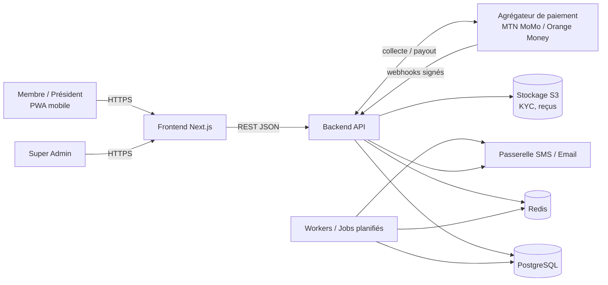
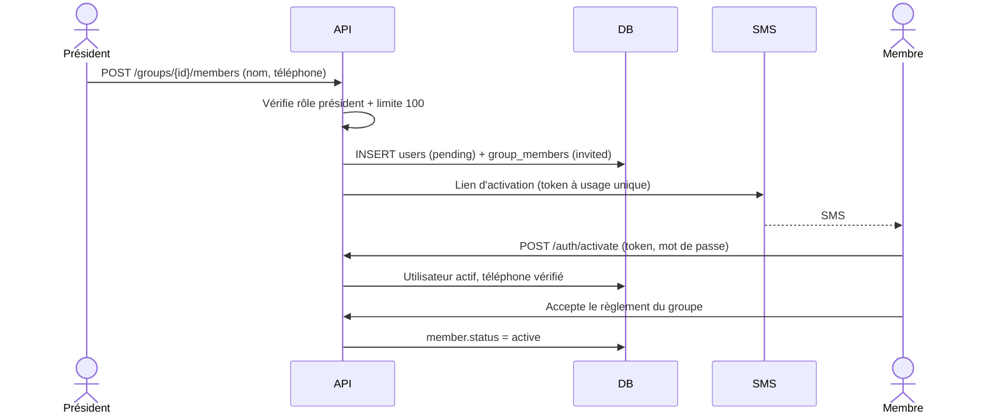
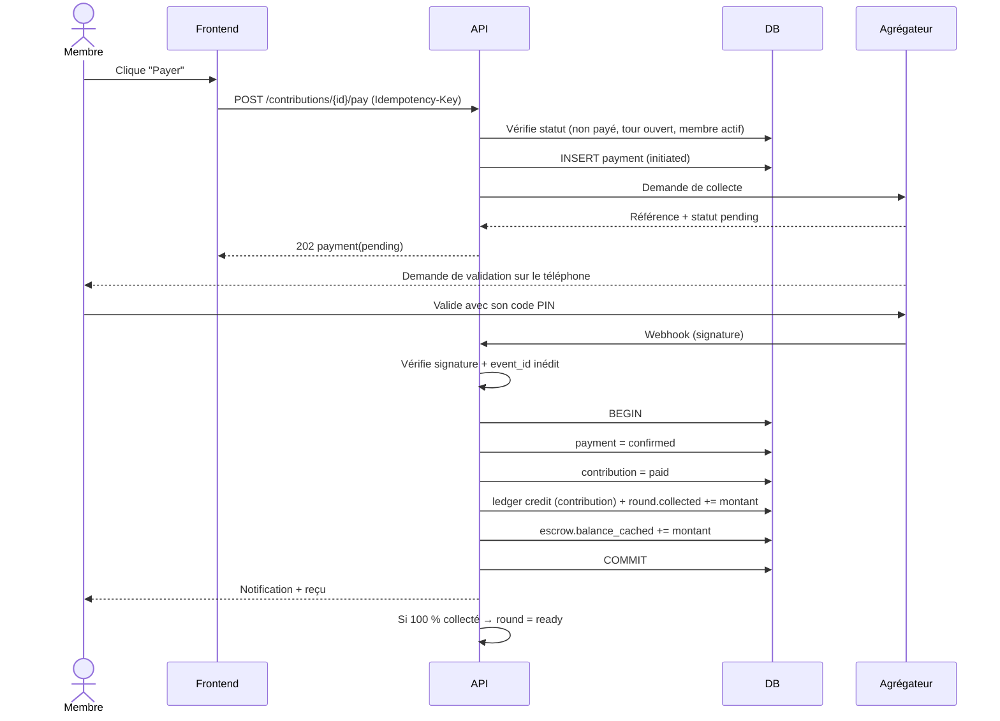
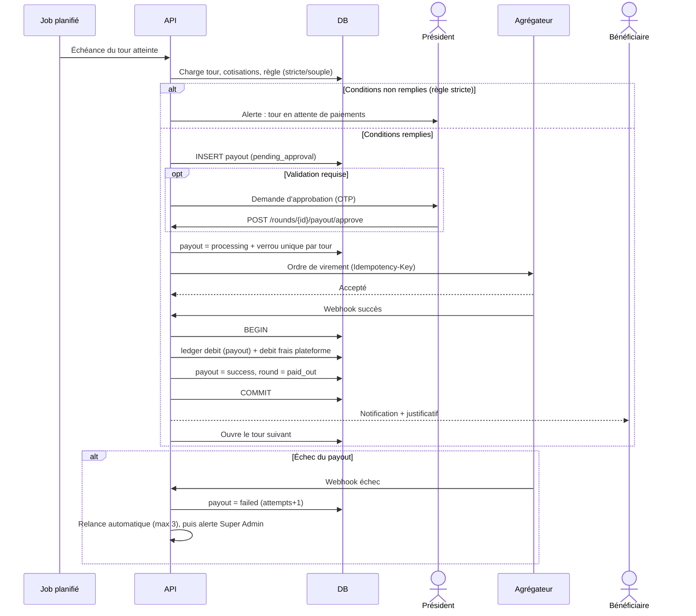
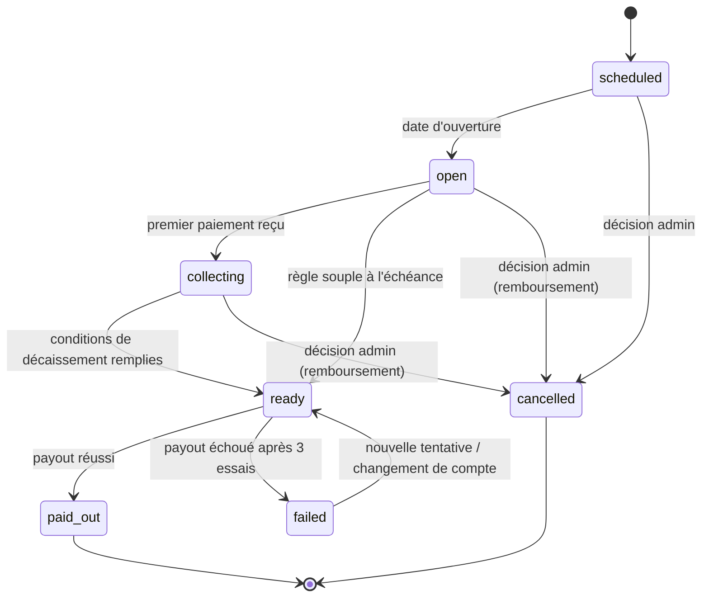
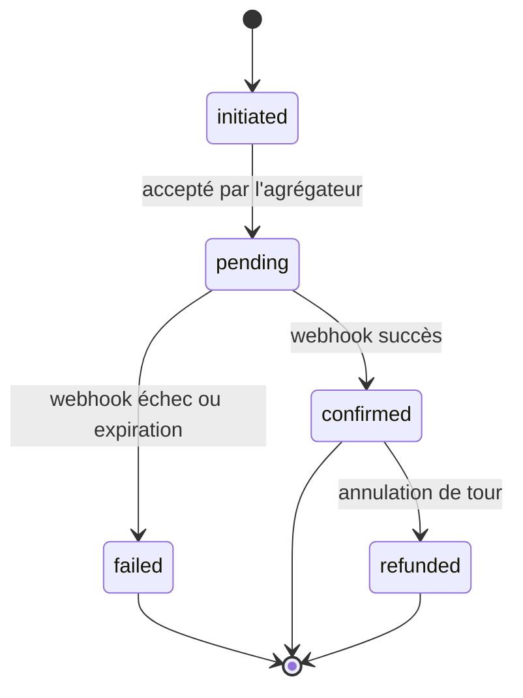
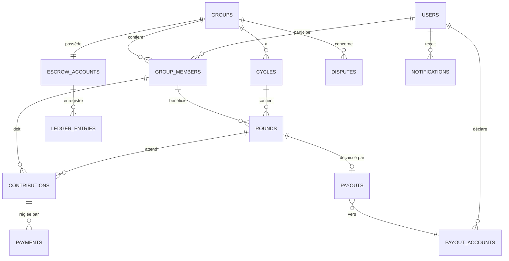

# Diagrammes et règles techniques – Plateforme Tontine

(Les blocs `mermaid` s'affichent dans GitHub, GitLab, Notion, VS Code avec extension, ou sur mermaid.live)

---

## 1. Architecture globale



---

## 2. Séquence – Création de membre par le président



---

## 3. Séquence – Paiement d'une cotisation



---

## 4. Séquence – Décaissement



---

## 5. États d'un tour



---

## 6. États d'un paiement



---

## 7. Modèle entité-relation simplifié



---

## 8. Règles de calcul

### 8.1 Montants d'un tour

```
N = nombre de membres actifs (ou de parts si plusieurs mains)
montant_attendu = N × cotisation            (si le bénéficiaire cotise)
montant_attendu = (N - 1) × cotisation      (sinon)
frais_plateforme = fixe  OU  montant_collecté × taux
net_bénéficiaire = montant_collecté - frais_plateforme - frais_opérateur_payout
```

Tous les calculs en entiers. Arrondi des pourcentages à l'unité XAF inférieure ; le reste d'arrondi va aux frais plateforme.

### 8.2 Pénalité de retard

```
si date_paiement > due_date :
  pénalité = late_fee_value                       (type fixed)
  pénalité = cotisation × late_fee_value / 10000  (type percent, valeur en centièmes de %)
```

La pénalité est ajoutée à la cotisation due et versée dans guarantee_balance.

### 8.3 Éligibilité au décaissement

```
règle STRICTE  : collected_amount == expected_amount
règle SOUPLE   : date >= payout_date
                 ET (collected_amount + guarantee_disponible >= expected_amount
                     OU président accepte un versement partiel)
Dans tous les cas :
  - round.status = ready
  - aucun payout actif/succès pour ce tour
  - compte de réception vérifié et actif depuis plus de 24 h
  - bénéficiaire en statut actif
```

### 8.4 Tirage au sort équitable

1. Générer une graine : `seed = CSPRNG(32 octets)`.
2. Enregistrer `seed` dans `cycles.draw_seed` et l'horodatage.
3. Mélanger les membres avec Fisher-Yates alimenté par un PRNG déterministe initialisé avec `seed`.
4. Affecter `position` 1..N ; générer les tours selon la fréquence.
5. Afficher la graine aux membres : le tirage est vérifiable.

### 8.5 Génération du calendrier

```
pour i de 1 à N :
  opens_on    = start_date + (i-1) × période
  due_date    = opens_on + payment_deadline_days
  payout_date = due_date + 1 jour
période : weekly = 7 j, biweekly = 14 j, monthly = +1 mois calendaire
```

### 8.6 Idempotence et concurrence

- Chaque paiement et décaissement porte une `idempotency_key` unique.
- Les webhooks sont dédoublonnés via `(provider, event_id)`.
- Le traitement d'un webhook, l'écriture du ledger et la mise à jour du tour se font dans **une seule transaction**.
- Le décaissement prend un verrou ligne (`SELECT ... FOR UPDATE`) sur le tour.
- L'index unique partiel `uq_payout_one_active_per_round` empêche tout double paiement au bénéficiaire.

### 8.7 Jobs planifiés

| Job                  | Fréquence         | Rôle                                     |
| -------------------- | ----------------- | ---------------------------------------- |
| open_rounds          | toutes les 15 min | Ouvre les tours arrivés à échéance       |
| send_reminders       | quotidien 08:00   | Rappels J-3, J-1, J, J+1                 |
| mark_late            | quotidien 00:05   | Marque en retard, applique les pénalités |
| process_payouts      | toutes les 10 min | Décaisse les tours prêts                 |
| retry_failed_payouts | toutes les 30 min | Relance (max 3)                          |
| reconcile            | quotidien 02:00   | Compare ledger et agrégateur             |
| expire_tokens        | horaire           | Nettoie OTP, invitations, sessions       |

---

## 9. Structure de projet recommandée (monorepo)

```
tontine/
├── apps/
│   ├── web/                  # Next.js (PWA)
│   │   ├── app/(auth)/ login, register, activate
│   │   ├── app/(member)/ dashboard, rounds, payments, profile
│   │   ├── app/(president)/ groups, members, draw, payouts
│   │   └── app/(admin)/ users, kyc, reconciliation, disputes, audit
│   └── api/                  # NestJS
│       └── src/
│           ├── auth/  users/  groups/  members/
│           ├── rounds/  contributions/  payments/
│           ├── escrow/  ledger/  payouts/
│           ├── notifications/  disputes/  admin/
│           ├── providers/    # adaptateurs MTN, Orange, agrégateur
│           ├── jobs/         # tâches planifiées (BullMQ)
│           └── common/       # guards, interceptors, audit
├── packages/
│   ├── shared-types/
│   └── ui/
├── db/ migrations/ seeds/
├── docs/ openapi.yaml, diagrams/
├── docker-compose.yml
└── .github/workflows/ci.yml
```

## 10. Variables d'environnement (exemple)

```
DATABASE_URL=postgres://...
REDIS_URL=redis://...
JWT_SECRET=...
JWT_ACCESS_TTL=900
JWT_REFRESH_TTL=2592000
PSP_PROVIDER=...
PSP_API_KEY=...
PSP_WEBHOOK_SECRET=...
SMS_PROVIDER_KEY=...
S3_BUCKET=...
ENCRYPTION_KEY=...           # chiffrement des documents KYC
APP_BASE_URL=https://...
```
